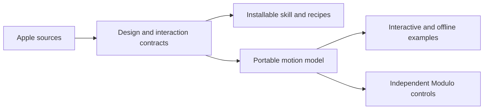
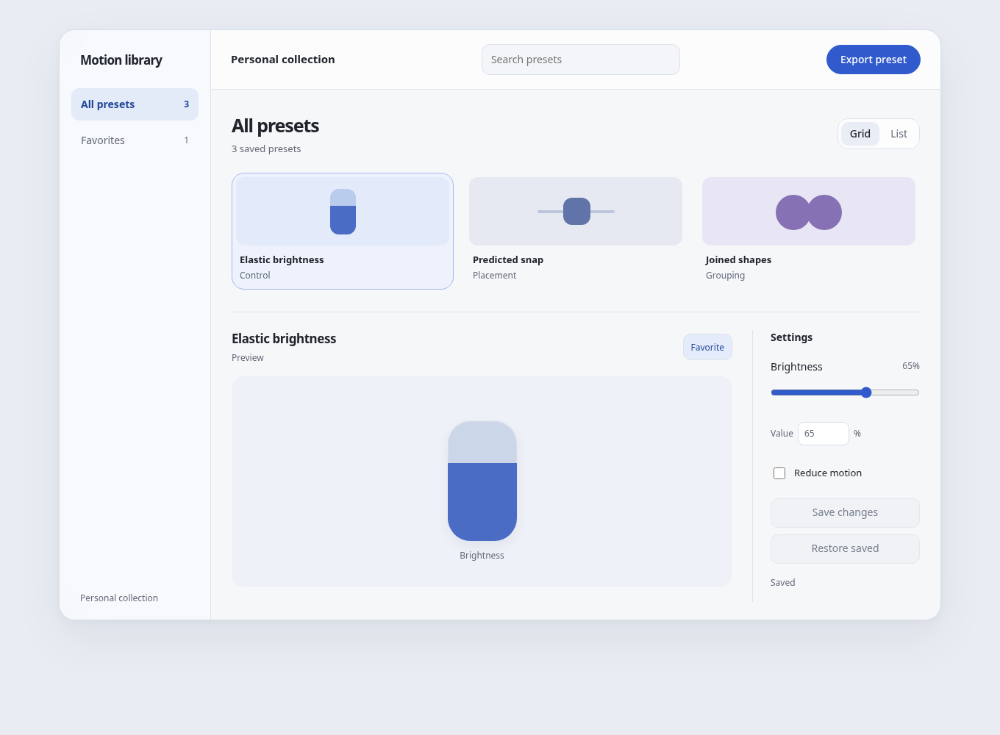
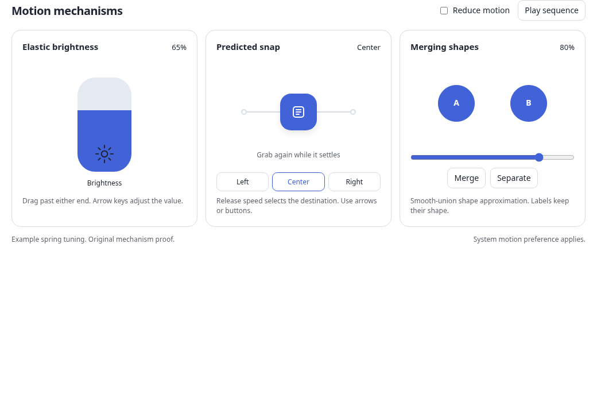

# Apple design and animation system

## Goal

Create `/home/maynkudu/Code/Projects/apple-design-and-animation-system` as the editable local Git repository.
Package the research as the platform-independent `apple-design-and-animation` skill, with design rules, recipes, runnable examples, and trajectory tools.
Add Elastic Slider, Snap Rail, and Liquid Cluster to Modulo as independent components, using its existing private-source and public-demo structure.

## Proposed system

The audience is you and the agents you use for apps, websites, animation, and motion graphics. The system should help them decide how an interface is organized, what each control means, and how its geometry and motion respond to input. Cover earlier iOS fluid interactions and iOS 26 Liquid Glass, with release and retrieval context for later HIG changes.

The representative design chapter is [Design foundations preview](foundations-preview.md). The [integrated system preview](system-preview.html) applies hierarchy, adaptive navigation, grouping, and one motion mechanism to a small working interface. It is an original adaptation, not an Apple screen reproduction or a new product to ship.

The integrated preview was operated at 1360 by 1000 and at 390 pixels wide. Its [desktop](system-preview-desktop.png), [narrow](system-preview-narrow.png), and [check notes](system-preview-notes.md) cover layout, keyboard adjustment, saving, reduced motion, and clean JavaScript execution. The narrow view had no horizontal overflow.

The previously approved [motion lab](../apple-motion/lab.html), [mechanism chapter](../apple-motion/mechanisms-preview.md), and [recording](../apple-motion/videos/proposed-motion-mechanisms.mp4) remain the motion proof. Its bounded brightness shell, velocity-projected snapping, and geometric merging have five numerical tests and thirteen actual browser observations. [Desktop](../apple-motion/desktop.png) and [mobile](../apple-motion/mobile.png) show the tested arrangements. The recorded replay uses simulated input. Native Apple behavior and exact visual fidelity remain unverified.

## Skill and repository responsibilities

| Location | Responsibility |
| --- | --- |
| `README.md` | Scope, local installation, invocation examples, runnable commands, evidence limits, and Modulo component locations. |
| `skills/apple-design-and-animation/SKILL.md` | Short entrypoint. Route by design problem, interaction, target platform, or offline medium. |
| `skills/apple-design-and-animation/references/` | Foundations, navigation and control contracts, springs, elastic sliders, snapping, liquid geometry and materials, shared transitions, platform adapters, offline animation, and verification. |
| `skills/apple-design-and-animation/scripts/` | Dependency-free analytic motion functions and timestamped trajectory sampling. Seconds and explicit coordinate units throughout. |
| `skills/apple-design-and-animation/assets/` | Self-contained motion lab and integrated design recipe. No external runtime assets. |
| `research/` | Curated source index, original synthesis, selected attributable evidence, retrieval dates, provenance, and unresolved details. Large Apple videos and third-party code stay in the isolated research archive. |
| `tests/` | Numerical invariants and an independent 6.1 Sol skill exercise report. |
| `~/.codex/skills/apple-design-and-animation` | Checked symlink to the repository skill after validation. No generated dotfiles rules are edited. |

The old `.plannotator/apple-motion/` archive retains its name so its evidence paths and hashes remain intact. There is no old production repository to rename. All new repository, skill, installation, and public-facing documentation names use the expanded scope.

## Modulo responsibilities

Use the existing Modulo layout, Geist typography, Rune Icons, source gate, registry, and package manager. Preserve current user changes. Do not redesign the gallery, auth, or existing components.

| Independent component | Local original source | Behavior |
| --- | --- | --- |
| `elastic-slider` | `/home/maynkudu/Code/Projects/modulo-elastic-slider` | Bounded stepped or continuous value, horizontal/vertical input, shell-only endpoint stretch, rigid content, controlled/uncontrolled state, change/commit, disabled and keyboard behavior. |
| `snap-rail` | `/home/maynkudu/Code/Projects/modulo-snap-rail` | Labeled detents, projected release destination, current-position re-grab, interruptible spring, direct keyboard selection. |
| `liquid-cluster` | `/home/maynkudu/Code/Projects/modulo-liquid-cluster` | Independent labeled buttons with stable IDs and a decorative distance-driven merged mask. Separate hit regions and accessible names remain usable if rendering fails. |

Each module contains its own React entrypoint, DOM runtime, scoped styles, and small motion helpers. Relative imports make it installable without Modulo's app code. No new animation dependency is required.

Tracked Modulo changes are limited to ignore rules, component catalog and documentation, three pages and demo wrappers, the exhaustive full-view map, selected media capture cases, and generated metadata-only `registry.json`. Implementations are copied only into ignored `src/registry/<slug>/` folders after ignore checks. Private source manifests remain ignored. See [the integration audit](modulo-integration-notes.md) for exact paths and the existing code relationships.

## Decisions

1. Define hierarchy and interaction meaning before material or motion. Use semantic typography and color roles, space-based grouping, adaptive layouts, and explicit control contracts. Avoid invented universal Apple spacing, RGB, font cutoffs, target sizes, or spring constants.
2. Keep raw input, semantic value, presentation geometry, velocity, destination, and gesture phase separate. Brightness remains bounded while its shell stretches. Dragging uses displacement; measured pressure is a separate optional capability.
   Count steps from the minimum. Fill, accessible value, callbacks, and exact entry use the same bounded stepped value. Distinguish cancellation from a successful commit. These decisions follow the inspected independent GPUI slider and Modulo runtime patterns.
3. Preserve current position and velocity through release, reversal, and retargeting. Select a snap target separately from the spring that reaches it. Keep the resistance mapping in the render path throughout settling to preserve the visual cap.
4. Treat proximity merging, identity-based morphing, and persistent union backgrounds as different operations. Explain smooth-union fields, metaballs, authored bridges, and physical fluid simulation separately. The example uses geometric blending.
5. Use native design and material APIs on supported Apple platforms. Give web, React Native, Compose, Flutter, and offline tools explicit state/unit adapters. Label platform examples that have not run. Avoid claiming that blur reproduces Apple's glass shaders or that every spring engine preserves opposing velocity.
6. Preserve labels, focus, selection, semantic bounds, and independent activation through deformation and merging. Support keyboard and assistive input, text enlargement, reduced motion, contrast preferences, and an opaque material fallback.

## Acceptance and publication boundary

Validate skill metadata, routed reference links, executable scripts, sampled trajectories, and the repository's actual names. Run the numerical tests and forward-test the skill with an independent 6.1 Sol agent in an isolated fixture. Operate the integrated example and Modulo previews on desktop/mobile, including interruption, hold/release, cancellation, keyboard, reduced motion, and clean console checks.

Generate and inspect the selected component JPG, GIF, and MP4 files. Run Modulo's lint, typecheck, access verification, and production build. Check anonymous source denial, temporary-key unlock and revocation, and disposable consumer installation. Separate local-copy checks from fresh source sync.

Modulo requires private repositories and full 40-character published commit pins. Local implementations, demos, checksums, and lock-entry drafts can be prepared without a commit or push. Do not insert a fake revision into `components.lock.json`. After the reviewed local work is complete, request explicit authorization to create the three private GitHub source repositories and commit/push their source. Only then finalize real lock pins and perform fresh-checkout sync/build checks. No public Modulo commit, push, deployment, or skill-repository publication is included in this local implementation approval.

Exact Apple control constants, proprietary corner curves and optical shaders, native-device verification, and pixel fidelity are not acceptance claims. The system distributes original guidance and examples, with no Apple font, SF Symbols, WWDC media, or unlicensed third-party implementation assets.
