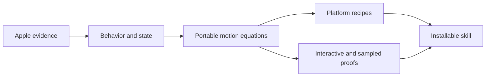
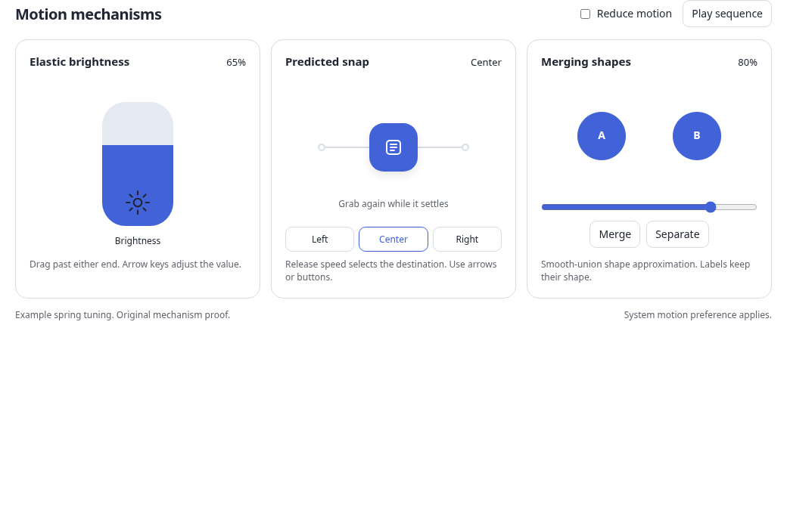

# Apple animations skill

## Goal

Create a local Git repository at `/home/maynkudu/Code/Projects/apple-animations-skill`.
Package Apple's documented motion principles and portable reconstructions into an installable `apple-fluid-motion` skill.
Prove the difficult mechanisms with runnable controls, numerical checks, and a realistic independent skill exercise.

## Proposed result

The audience is you and the coding or animation agents you use. The skill should help them construct an interaction, port its behavior to another renderer, and verify it. It should not turn every animation into a spring or present a blur filter as Apple's Liquid Glass implementation.

Cover both generations. Earlier iOS explains direct manipulation, interruption, velocity handoff, momentum projection, and settling. iOS 26 adds a distinct study of Liquid Glass material, elastic controls, and merging or separating shapes. Public documentation, observed demonstrations, and proposed implementation choices will have separate labels.

The representative chapter is [Stretching a brightness control](mechanisms-preview.md). The representative interaction proof is [Proposed motion lab](lab.html). These examples are original mechanism demonstrations, not pixel-matched reproductions or measured Apple spring presets.

The preview shows a bounded brightness value with elastic shell deformation, a draggable item with velocity-sensitive detents, and a smooth-union liquid bridge. A deterministic replay, keyboard controls, cancellation, re-grab, and reduced motion make the behavior inspectable.

| Review evidence | What it establishes |
| --- | --- |
| [Proposed recording](videos/proposed-motion-mechanisms.mp4) | The replay shows stretch and return, snapping, merging and separation, followed by the reduced-motion result. The replay simulates the input path. |
| [Desktop](desktop.png), [upper-end stretch](upper-stretch.png), [mobile with reduced motion](mobile.png) | Rendered layout and control states at 1040 by 700 and 390 by 1200. |
| [Browser observations](browser-evidence.json) | Thirteen focused observations using actual pointer and keyboard input, including a flick, re-grab while settling, lost capture, and a hot system preference change. |
| [Apple source synthesis](research/apple-primary.md), [portable mechanisms](research/portable-motion.md), [source frame observations](research/visual-observations.md) | Documented behavior, derived equations, and explicitly limited visual observations. |

## File responsibilities

| File or directory | Purpose |
| --- | --- |
| `README.md` | Scope, evidence limits, installation, invocation, and example commands. |
| `skills/apple-fluid-motion/SKILL.md` | Short skill entrypoint with routing by interaction and target platform. |
| `skills/apple-fluid-motion/references/` | Deep analysis of Apple evidence, springs and continuity, elastic controls, snap decisions, liquid geometry and optics, platform recipes, offline motion, and verification. |
| `skills/apple-fluid-motion/assets/lab.html` | Self-contained interactive examples that work from a file URL. |
| `skills/apple-fluid-motion/scripts/` | Dependency-free motion equations and trajectory sampling for other renderers or offline keyframes. |
| `tests/` | Focused numerical invariants and an independent skill exercise report. |
| `research/` | Source index, claim provenance, retrieval dates, selected evidence, and remaining gaps. |

The repository will contain original prose and implementation examples. External code or large Apple media downloads will not become unlicensed vendored assets. Source URLs and short attributable excerpts will support the analysis.

After validation, expose the skill to Codex with a symlink at `~/.codex/skills/apple-fluid-motion`. Check for an existing skill before creating it. The repository remains the editable source.

## Decisions to review

1. Keep semantic value, presentation state, velocity, and gesture phase distinct. Brightness clamps at its endpoints while the decorative shell can stretch.
2. Spring the latent displacement and apply the resistance mapping each frame. This preserves the stretch cap even during an outward release.
3. Choose snap destinations from position and release velocity. Use hysteresis for previewed selection, and carry current presentation state through interruption.
4. Explain smooth-union fields, metaballs, authored bridges, and actual surface-tension simulation as different options. The included liquid example is a geometric approximation.
5. Translate the same state and units to SwiftUI/UIKit, web, React Native, Android Compose, Flutter, and offline animation tools. Verify API claims against the inspected version and label unrun platform examples.

## Acceptance and limits

The numerical proof already checks frame partition independence at 30, 60, and 120 fps, retarget continuity, resistance velocity mapping, snap hysteresis, and the derived liquid-bridge separation threshold.

The browser proof exercised real pointer and keyboard input, stretching at both endpoints, release after a hold, a flick, re-grab during settling, lost capture, narrow layout, reduced motion, and a clean console. Automated accessibility checks reported no violations. Canvas letter contrast still needs manual interpretation; the ARIA group warning was corrected. A replay recording supplements these checks.

The skill will be forward-tested on a small new request by an independent 6.1 Sol agent. Skill metadata, reference links, scripts, and actual sampled output must validate before closeout.

Exact Apple brightness-control constants, proprietary optical shaders, and pixel fidelity are not claimed. No Apple device interaction has been verified on this Linux machine. Platform recipes that cannot run here will say so.

This creates and initializes a local repository. It does not commit, push, publish a remote repository, or modify the generated dotfiles rules. Research and preview preparation remain isolated under `.plannotator/apple-motion/` until the plan is approved.
