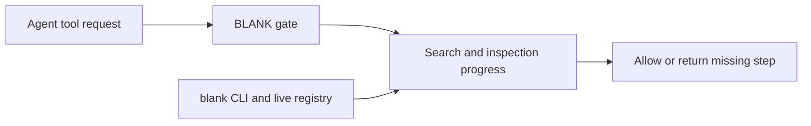

# BLANK gate update from d4f2eeb

## Goal

Existing instructions let agents skip BLANK discovery. Upstream now enforces searches and source inspection before building.
Port that gate to maynkudu's CLI workflow and install it for the configured Codex and Claude agents. Credentials remain in `~/dotfiles/kiys`.
Prove the gate decisions, live authenticated source access, configuration preservation and Codex hook trust, then commit the update.

Source is [kiritocode1/dotfiles at d4f2eeb](https://github.com/kiritocode1/dotfiles/commit/d4f2eebddf680057c8869419fc0090a5ecd01573). The exact source files and blob hashes are pinned in [source.json](source.json) and `upstream/`.

## Behavior and representative proof

This adopts upstream's stricter scope. It replaces the current discovery exemption for small edits, bug fixes, refactors and exact sources. Reading code stays allowed. Explicit task instructions take precedence.



The shared hook normalizes native tool names, checks session progress and returns exit code 2 when a required step is missing. Searches and visits update progress after the tool completes.

- General edits, supported web searches, browser opens and installs need a BLANK search.
- UI file edits need a component or page search and inspection of a returned BLANK match. Then install a fit, or inspect available inspiration sources when none fits.
- Server file edits need a backend search and source inspection. Repeated searches with no references have bounded recovery.
- Failed searches count as attempts. Failed source reads, page visits and installs do not count as successful inspection or reuse.

The isolated preview has passed [29 focused tests](preview-tests.log). They exercise all upstream payload shapes plus CLI recognition, failed installs, browser session flags, concurrent progress, selected-agent installation, preserved settings, symlinks, repeated installs and real Codex hook trust.

[Live preview evidence](live-preview.json) used the existing `kiys` file without copying credentials. The catalog returned 375 items. `blank source word-highlight-scroll` returned one source file with content. The gate blocked a UI patch before searching, before source inspection, and before reuse. Temporary session progress recorded the inspected component.

## File responsibilities

| Files | Result |
| --- | --- |
| `bin/blank` | Add `registry-search --section all\|components\|pages\|backend`. Joint search uses `/direction/discover`. Existing stdin and child-environment credential handling stays in use. |
| `skills/hooks/blank-direction-gate` | Port the upstream gate, recognize the CLI and T3 browser tools, check failed command status, and preserve concurrent progress without recording raw responses or credentials. |
| `skills/hooks/*-blank-direction.ts` | Keep the upstream Pi and OpenCode adapters available when those agents are selected. |
| `skills/bin/install` | Install hooks only for selected agents. Preserve unrelated settings and handlers, back up changes, avoid writes through foreign symlinks, and trust the exact BLANK hook hashes returned by Codex. Disable plugin synchronization only for this metadata process. |
| `skills/rules/core/direction-first*.md` and `skills/skills/blank-direction/SKILL.md` | Describe the enforced order, CLI commands, source inspection and failed-search recovery. Keep credentials in `kiys`, without the upstream author's machine paths or shell exports. |
| `tests/test_blank*.py` and `tests/test_setup.py` | Verify observable request, gate and installer behavior. |
| `docs/blank.md`, `skills/README.md`, `README.md` | Document the installed workflow and credential source. |
| `skills/build/` | Regenerate all five rule outputs from their sources. Codex fits its existing 24,576-character cap at 24,513 characters. |

Production files and installed agent configuration have not changed. Preview preparation is isolated under `preview/`.

## Decision-bearing changes

The full proposed source diff is [preview.patch](preview.patch). The main adaptations are needed because upstream expects a local MCP server and a token in `~/.zshenv`.

The actual local workflow will be:

```bash
blank registry-search 'scroll text' --section components
blank search 'scroll driven gallery'
blank source word-highlight-scroll
blank configure .
blank shadcn add @compronents/word-highlight-scroll
```

Configure and install commands apply only to a target app authorized by the user's task. The source command provides inspection without initializing an unrelated app.

Codex receives `PreToolUse` and `PostToolUse` command hooks pointing to `~/dotfiles/skills/hooks/blank-direction-gate`. Claude also receives `PostToolUseFailure` and narrow allow rules for the read-only `blank search`, `blank registry-search` and `blank source` commands. Its existing permissions remain present. The installer records Codex trust only for these reviewed gate definitions.

After approval, copy the checked preview changes into production, rebuild generated rules, install for Codex and Claude, verify the installed configuration and live CLI, then commit the implementation and compact evidence.

## Omissions and verification limits

The unrelated upstream Vercel plugin installation and Mac bootstrap changes are outside this BLANK update. No private MCP server, design pack or credential export is added.

Full execution inside a fresh agent conversation remains unverified until a new session loads the hooks. Optional Pi, Grok and OpenCode adapters have payload and installation checks, without live agent runs. The gate classifies supported tool requests and file paths. It does not detect arbitrary file writes hidden inside shell scripts, and Codex hosted web searches do not expose these hooks.

The live service reports unavailable reranking while returning ranked results. The gate cannot repair that remote feature. A speed improvement is unmeasured.

Approval covers the stricter rule, the concrete CLI and gate diff, configured-agent installation and exact Codex hook trust. The requested commit follows successful verification.
