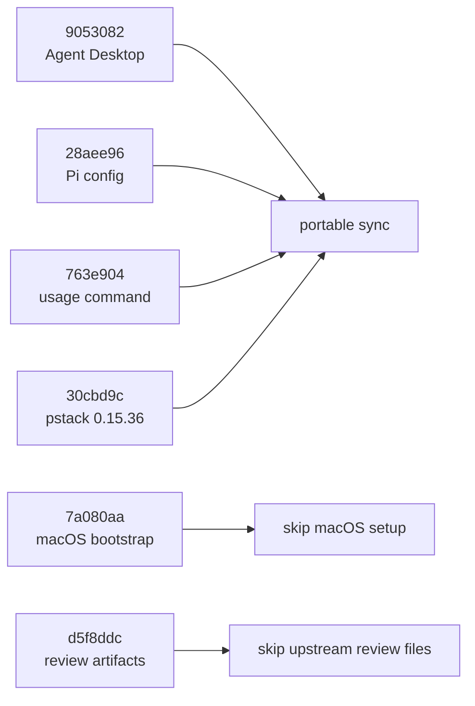

# Sync kiritocode1/dotfiles through 30cbd9c

## Goal

Bring the portable changes from reference commits `9053082..30cbd9c` into the current Arch Linux repository while preserving the local setup introduced by `e8c34b5` and the uncommitted `google-seo` addition.

The merge is complete when the selected behavior is represented in source files, generated agent files are rebuilt, focused repository tests pass, and no macOS-only configuration becomes part of the active Arch setup.

The proof will be the final Git diff plus `skills/bin/build`, `skills/bin/check --repo-only`, the focused Python tests, and shell syntax checks.

## What changed upstream

The temporary three-way merge found conflicts in `README.md`, `skills/README.md`, `skills/docs/how-it-works.md`, `skills/manifest.toml`, `skills/rules/shared/ui-verification.md`, `zshrc`, and four generated files. The generated files do not need separate decisions.

## Recommended resolution

| Area | Keep from this repo | Bring from the reference | Resolution |
| --- | --- | --- | --- |
| Platform setup | Arch installer, `setup.toml`, portable shell files, current README | None of the Homebrew bootstrap, macOS `zprofile`, Ghostty/Zed/Television settings, `claude-acct`, or WhatsApp automation | Skip the macOS bootstrap commit's machine setup. It assumes Homebrew, `/Applications`, macOS Keychain, AppleScript, and launchd. |
| Desktop verification | Current short rule plus detailed `skills/reference/ui-verification.md` | Agent Desktop routing and skill tracking | Add `agent-desktop` to the Arch npm tool list and route native Linux desktop work to it. Its official README supports Linux through AT-SPI. Preserve Argent for devices, React Native, Electron, and existing CDP sessions. |
| Skill inventory | Current `sources.lock.json` installer model and historical-manifest framing | pstack move from `poteto/plugins` to `cursor/plugins` at commit `4dd1d05`, the expanded 56-skill list, Agent Browser and Agent Desktop entries, deletion of `use-computer-mcp` | Translate the upstream manifest change into both `manifest.toml` and `sources.lock.json`. Keep the existing collision handling for `bro`, `teach`, and `pstack-tdd`. |
| Pi | Current `openai-codex` default and user-neutral documentation | Updated package list and safer restore logic | Import the package and restore improvements. Do not make Aryan's `codex-pool`, multiple Plus grants, CPA provider, or `gpt-6-astra` the default. Omit `pi/extensions/codex-pool.ts` unless explicitly requested. |
| Usage command | Existing local CLIProxyAPI helper | Claude and xAI grant reporting, cooldown parsing, `--all` behavior | Import the functional update and replace the upstream personal filter example with a generic example. |
| Documentation | Current maynkudu and Arch wording | Short notes for Agent Desktop and the pstack source move | Preserve the current documents. Add only the new behavior that applies here. Skip the upstream `.plannotator` review records. |
| Generated files | Nothing edited by hand | Rebuilt output after source resolution | Run `skills/bin/build` after editing source rules. |

## File responsibilities after the sync

| Source | Responsibility |
| --- | --- |
| `setup.toml` | Active Arch tools, including `agent-desktop`, while retaining the uncommitted `google-seo` skill entry |
| `skills/sources.lock.json` | Pinned public skill sources and exact paths |
| `skills/manifest.toml` | Historical inventory with the latest upstream source information |
| `skills/rules/shared/ui-verification.md` | Short always-loaded routing rule |
| `skills/reference/ui-verification.md` | Full browser, device, and desktop verification procedure |
| `skills/vendored/dmmulroy/patches.toml` | Delete the retired `use-computer-mcp` skill |
| `pi/settings.json`, `pi/package.json`, `pi/restore.sh`, `pi/README.md` | Portable Pi packages and restore behavior without account assumptions |
| `bin/usage` | CLIProxyAPI grant reporting |
| `skills/build/**` | Generated output from source rules |

## Verification

1. Re-run the three-way comparison and confirm no selected reference change is missing.
2. Run `python3 skills/bin/build` and confirm generated files match their sources.
3. Run `python3 skills/bin/check --repo-only`.
4. Run `python3 -m unittest discover -s tests -v`.
5. Run `bash -n shell/common.sh shell/bash.sh pi/restore.sh` and `zsh -n zshrc`.
6. Parse `setup.toml`, `skills/manifest.toml`, and `skills/sources.lock.json` with their existing checks.

## Deliberate omissions

- macOS bootstrap files and personal application settings from `7a080aa`
- Aryan's Claude account switcher and WhatsApp automation
- the upstream `codex-pool` provider and account-count claims
- upstream Plannotator planning and review artifacts
- any commit or push

Approval accepts this conservative resolution. Annotate the rows above if you want a macOS file, the full `codex-pool` Pi setup, or an upstream review artifact kept.
