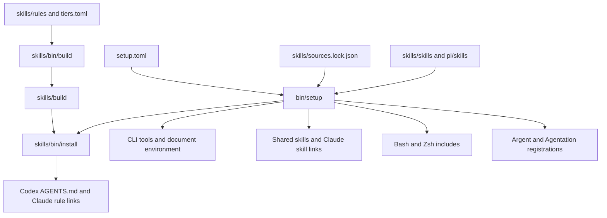

# Dotfiles walkthrough

This repository configures maynkudu's Arch Linux environment for websites, apps,
and documents. Codex is the primary agent and Claude Code is the second. The
setup keeps Aryan's writing and design preferences while using maynkudu's
identity, paths, and selected tools.

This walkthrough describes the checkout and machine inspected on 2026-10-28.
The checkout was on `main` at `01aa6256b7dad35dc7a23a145e506254d9de2f81`, with
uncommitted setup changes. Counts and runtime results below describe that state.

The core setup is installed and has passed the checks described below. Some
references still depend on separate applications, accounts, or private access.
WhatsApp is missing. BLANK's supplied inspiration passphrase and registry token
have now been verified, and access is installed through the `blank` command and
shared `blank-direction` skill. Its public indexes and search endpoints are also
accessible. The [integration inventory](#integrations-that-are-missing-restricted-or-unverified)
records those distinctions.

## What the repository manages

There are three different kinds of configuration here:

| Kind | What it does | Example |
| --- | --- | --- |
| Rules | Give agents standing instructions about behavior and preferences | Read a file before editing it |
| Skills | Supply instructions, examples, and sometimes scripts for a particular task | Generate a spreadsheet or inspect an Android app |
| Tools | Perform the actual operation | `agent-browser`, `argent`, `doc-python` |

A skill can be installed while its required application or account is missing.
An MCP registration tells an agent how to launch or connect to a tool server.
It does not prove that every operation behind that server works.

Rules guide the agent. They do not intercept shell commands or enforce operating
system permissions. For example, installing the `git-guardrails-claude-code`
skill does not itself install Git protection hooks. `bin/setup` does not perform
that hook setup.

## Where everything lives

| Path | Purpose |
| --- | --- |
| [README.md](README.md) | Short introduction and setup commands |
| [setup.toml](setup.toml) | Active agents, npm tool selection, native build permissions, and selected local skills |
| [bin/setup](bin/setup) | Installs tools, skills, rules, shell includes, and MCP registrations |
| [bin/doctor](bin/doctor) | Checks installed commands, document libraries, native storage, rules, and skills |
| [bin/blank](bin/blank) | BLANK discovery, authenticated source, shadcn configuration, and browser login |
| [bin/usage](bin/usage) | Optional live Codex usage lookup for CLIProxyAPI accounts |
| [shell/common.sh](shell/common.sh) | Shared paths, editor selection, and aliases |
| [shell/bash.sh](shell/bash.sh) | Interactive Bash integration |
| [zshrc](zshrc) | Interactive Zsh integration |
| [documents/requirements.txt](documents/requirements.txt) | Pinned document libraries |
| [skills/rules/](skills/rules/) | Source rules that should be edited |
| [skills/rules/tiers.toml](skills/rules/tiers.toml) | Rule selection, ordering, and character budgets for each agent |
| [skills/reference/](skills/reference/) | Detailed procedures loaded when relevant |
| [skills/build/](skills/build/) | Generated agent profiles |
| [skills/bin/](skills/bin/) | Rule building, installation, checks, patches, and historical audit utilities |
| [skills/skills/](skills/skills/) | Bundled local skills, including some optional ones |
| [skills/sources.lock.json](skills/sources.lock.json) | Public skills selected by repository, source path, and exact commit |
| [skills/vendored/](skills/vendored/) | Local patches applied to installed upstream skills |
| [skills/manifest.toml](skills/manifest.toml) | Historical inventory, including private or unavailable entries |
| [skills/profile/](skills/profile/) | Historical profiles, audits, and retired instructions |
| [pi/](pi/) | Optional Pi configuration, image tooling, and bundled Cloudflare skills |
| [claude/sync-rules.sh](claude/sync-rules.sh) | Compatibility wrapper for the retired Claude rule installer |
| [docs/setup.md](docs/setup.md) | Installation details, prerequisites, repair commands, and limits |
| [docs/blank.md](docs/blank.md) | Installed BLANK access and credential handling |
| [docs/cliproxyapi.md](docs/cliproxyapi.md) | Older proxy documentation that needs interpretation for this machine |
| [tests/test_setup.py](tests/test_setup.py) | Focused installer tests |
| [skills/tests/test_audit_adherence.py](skills/tests/test_audit_adherence.py) | Tests for the history-audit utility |
| [.plannotator/setup-verification/](.plannotator/setup-verification/) | Saved setup checks, sample exports, screenshots, recording, and review result |
| [.gitignore](.gitignore) | Excludes `kiys`, Python caches, and specific Pi credentials, sessions, and generated state |

The hundreds of files below `pi/skills/cloudflare/references/` are reference
material grouped by Cloudflare product. They are read when needed. They are not
services that start when this repository is installed.

## How installation works

The normal entrypoint is [bin/setup](bin/setup). It reads [setup.toml](setup.toml)
and runs the selected phases in this order:

1. Install missing tools and prepare their supporting environments.
2. Install missing public skills and link bundled skills.
3. Check and install generated rules.
4. Add or update shell includes.
5. Register the selected MCP servers.

With no phase flags, it runs all five. Multiple flags select a subset without
changing their order.



The diagram shows configuration flow. The numbered list gives execution order.
The rules phase runs the builder with `--check`; it refuses stale generated
files. Build source changes before installing them.

```bash
cd ~/dotfiles
python3 skills/bin/build
python3 bin/setup --dry-run
python3 bin/setup
python3 bin/doctor
```

On another machine, install the prerequisites listed in
[docs/setup.md](docs/setup.md) first. They include Python 3.11+, Node 24+, npm,
Git, Cargo, uv, the selected agents, and the system tools used for verification.
The skills phase also requires Codex's bundled skill-installer helper.

Useful partial runs are:

```bash
python3 bin/setup --tools --skills
python3 bin/setup --rules --shell
python3 bin/setup --mcp
```

The installer retains commands already found on `PATH` and existing public skill
directories. Repeating it fills gaps; it does not force every existing tool or
skill to the version in the configuration. The document dependencies are
reconciled with their requirements file, and the declared skill patches are
reapplied during the skills phase.

Configuration replacements receive a timestamped `.before-dotfiles-<timestamp>`
backup beside the original. Unchanged rule and shell installation does not keep
creating backups. The installer preserves existing shell content and model or
provider selections. It does not change the login shell or configure accounts.

`--home <directory>` supports isolated rule, shell, and skill installations.
MCP registration refuses an alternate home because it uses the real agent CLIs.
If a command fails, setup stops and retains completed work so it can be rerun
after the failure is resolved.

## Rules, generated profiles, and references

[skills/rules/tiers.toml](skills/rules/tiers.toml) defines five build targets:
Codex, Claude, Grok, Pi, and OpenCode. [setup.toml](setup.toml) selects only Codex
and Claude for the default installation.

[skills/bin/build](skills/bin/build) resolves each selected rule, preferring an
agent-specific variant such as `about-me.grok.md` when present. It generates all
target outputs and checks their character budgets before writing them.

Codex and Claude each receive 16 rules. They cover these subjects:

| Rule | Effect on daily work |
| --- | --- |
| `mannered-prose` | Use literal language instead of decorative metaphors |
| `about-me` | Use maynkudu's identity, Arch environment, coding preferences, and design constraints |
| `unslop` | Apply the detailed writing checks |
| `aryan-voice` | Load the inherited voice guide for website copy, component text, and relevant messages |
| `direction-first` | Inspect the project and useful references before open design choices |
| `fidelity-first` | Pin sources and compare exact reproductions against them |
| `read-before-edit` | Read the complete file and trace relevant values before editing |
| `ui-verification` | Operate the real UI and check the result against the accepted brief |
| `documents` | Use the matching document skills, extraction tools, and isolated environment |
| `argent` | Use the relevant device workflow for native and related app work |
| `portless` | Use stable local hostnames and respect existing processes |
| `webreel` | Configure, validate, record, and verify repeatable browser videos |
| `waiting` | Wait for a real condition with the available session or event tools |
| `context7` | Resolve and fetch current library documentation before web documentation lookups |
| `plannotator` | Review concrete implementation plans and material departures |
| Agent profile | Apply the Codex or Claude instructions for working with maynkudu |

The source files are under [skills/rules/core/](skills/rules/core/),
[skills/rules/shared/](skills/rules/shared/), and
[skills/rules/agent/](skills/rules/agent/).

Longer instructions live in [skills/reference/](skills/reference/). They cover
writing, UI verification, substantial verification infrastructure, devices,
local servers, recordings, and plan review. Keeping those procedures separate
reduces the instructions loaded for every task.

The inspected Codex output contains 24,017 characters against a 24,576-character
cap. Grok has a separate 10,000-character cap and a smaller rule selection.
Those limits are character counts, not token counts.

[skills/bin/install](skills/bin/install) installs the selected profiles as follows:

| Agent | Installed destination | Installation form |
| --- | --- | --- |
| Codex | `~/.codex/AGENTS.md` | A real copied file |
| Claude | `~/.claude/rules/` | 16 individual symlinks into `skills/build/claude/rules/` |

Individual Claude links preserve unrelated local rule files. Codex's copied
profile needs another install after a rebuild. Claude's links follow the built
files, but a new session is still the reliable way to load updated rules.

Edit the source rules and rebuild. Changes made directly to `skills/build/` or
the installed Codex copy are replaced by later builds or installs. Keep this
checkout in place because Claude rules, bundled skills, and shell includes refer
to it.

## How skills are installed and shared

The current managed selection contains 125 skills:

| Source | Count | Installation |
| --- | --- | --- |
| Public repositories in `skills/sources.lock.json` | 105 | Download missing skills at pinned source commits |
| Local skills selected in `setup.toml` | 7 | Link into this checkout |
| Bundled Cloudflare skills in `pi/skills` | 13 | Link into this checkout |

The inspected `~/.agents/skills` collection contains 132 skills, and Claude sees
132 through `~/.claude/skills`. The seven additional entries already present are
`anatomy`, `plannotator`, `plannotator-annotate`, `plannotator-last`,
`plannotator-review`, `supabase`, and `supabase-postgres-best-practices`. These
counts exclude Codex's separate system-skill directory.

Codex discovers the shared `~/.agents/skills` directory. Claude receives
individual links to shared skills. The installer retains existing copies, so a
lock-file entry controls a missing installation; it is not proof that an older
retained copy matches that commit.

The public selection comes from these repositories:

| Repository | Selected skills | Main subject |
| --- | --- | --- |
| `addyosmani/web-quality-skills` | 1 | Web performance |
| `anthropics/skills` | 6 | Frontend design and document work |
| `arla6ka/skills` | 6 | Design systems, component documentation, and UI review |
| `benjitaylor/agentation` | 2 | Annotation-driven UI work |
| `dmmulroy/.dotfiles` | 5 | Writing, discoverability, Herdr, and recipe diagrams |
| `firecrawl/anydoc` | 1 | Document extraction |
| `makisuo/skills` | 1 | Effect patterns |
| `mattpocock/skills` | 30 | Engineering, research, planning, and productivity workflows |
| `poteto/plugins` | 34 | pstack workflows, TypeScript, and engineering principles |
| `shadcn/improve` | 1 | Codebase improvement advice |
| `software-mansion/argent` | 15 | Device setup, interaction, testing, and profiling |
| `vercel/ai` | 1 | AI SDK |
| `vercel-labs/agent-skills` | 1 | React practices |
| `vercel-labs/skills` | 1 | Skill discovery |

The exact names, paths, and commits are in
[skills/sources.lock.json](skills/sources.lock.json).

The seven selected local skills have separate jobs:

| Skill | Purpose |
| --- | --- |
| [blank-mode](skills/skills/blank-mode/SKILL.md) | Inherited working preferences adapted for this setup |
| [aryan-voice](skills/skills/aryan-voice/SKILL.md) | Writing guidance and inspected examples, without adopting Aryan's identity |
| [animation-fundamentals](skills/skills/animation-fundamentals/SKILL.md) | Bundled motion recipes, interaction patterns, and a local motion lab |
| [router-process](skills/skills/router-process/SKILL.md) | Guide to explicitly invoked engineering workflows |
| [router-design](skills/skills/router-design/SKILL.md) | Optional design catalog with availability checks |
| [subsystem-modeling](skills/skills/subsystem-modeling/SKILL.md) | Source-linked explanations, dependency diagrams, and execution walkthroughs |
| [blank-direction](skills/skills/blank-direction/SKILL.md) | Live BLANK discovery, authenticated registry source, and inspiration access |

The 13 bundled Cloudflare skills are `agents-sdk`, `cloudflare`,
`cloudflare-email-service`, `cloudflare-one`, `cloudflare-one-migrations`,
`durable-objects`, `sandbox-migrate-to-next`, `sandbox-next`, `sandbox-stable`,
`turnstile-spin`, `web-perf`, `workers-best-practices`, and `wrangler`.
They are available to Codex and Claude even though Pi is an optional install target.

[skills/manifest.toml](skills/manifest.toml) is the historical inventory. The
installer does not read it. A name there, or in `router-design`, does not establish
that its skill or private resource is available.

### Local patches to upstream skills

[skills/bin/patch](skills/bin/patch) applies declarations under
[skills/vendored/](skills/vendored/). The declarations rename pstack's TDD skill,
adjust document and Agentation triggers, add Agentation usage guidance, and make
the discoverability and agent-writing skills eligible for automatic invocation.
They also declare removal of `impeccable` and the unrelated `workday-training`
skill, and contain an optional Computer Use appendix.

Setup scopes this operation to `~/.agents/skills`. Missing skills are skipped.
The earlier patch check passed for the installed collection, with Computer Use
skipped because its skill is absent. A patch declaration does not fetch the
missing skill or install its application.

## Bash and Zsh

The installer keeps existing `~/.bashrc` and `~/.zshrc` content and adds one managed
include to each. Those includes set `DOTFILES_ROOT` and source
[shell/bash.sh](shell/bash.sh) or [zshrc](zshrc).

Both shells load [shell/common.sh](shell/common.sh). It adds existing local tool
directories to `PATH`, uses Neovim as `EDITOR` when available, sets `VISUAL`, and
defines these aliases:

| Alias | Command |
| --- | --- |
| `pn` | `pnpm` |
| `pni` | `pnpm install` |
| `pnd` | `pnpm dev` |
| `pnb` | `pnpm build` |
| `pnl` | `pnpm lint` |
| `pnt` | `pnpm test` |
| `pns` | `pnpm start` |
| `buni` | `bun install` |
| `bunr` | `bun run` |
| `bund` | `bun dev` |
| `bunb` | `bun run build` |
| `gst` | `git status --short` |
| `gd` | `git diff` |
| `gpl` | `git pull` |
| `gplr` | `git pull --rebase` |
| `gp` | `git push` |
| `gc` | `git commit` |
| `ll` | `eza -lah --git`, or `ls -lah` when eza is missing |
| `lt` | `eza --tree --level=2`, defined only when eza is installed |

`pnd` runs the project's development script directly. It does not wrap the command
in Portless. Named local URLs use the Portless workflow described below.

Bash enables appended history, retains 50,000 entries in memory and 100,000 in its
history file, and ignores duplicate or leading-space history entries. It loads
fnm, Starship, and Zoxide when installed.

Zsh enables completion, shared history, Emacs-style key bindings, and changing
directory by typing a directory name. It loads fnm, Starship, Zoxide,
zsh-autosuggestions, and zsh-syntax-highlighting when available. It includes a
simple fallback prompt and a double-Tab autosuggestion binding when supported.

`~/.bashrc.local` and `~/.zshrc.local` load at the end of the corresponding
dotfiles integration. Put machine-specific shell overrides there. The shared
configuration leaves standard command names such as `cd`, `cat`, and `grep`
intact and does not add an alias for `codex`.

## Installed tools and their roles

[setup.toml](setup.toml) selects these npm packages for commands that are missing:

| Command | Selected package | Used for |
| --- | --- | --- |
| `argent` | `@swmansion/argent@0.30.1` | Native, device, and Chromium app inspection through the appropriate workflow |
| `webreel` | `webreel@0.1.4` | Repeatable browser demo recordings |
| `ctx7` | `ctx7@0.8.2` | Current documentation lookup |
| `anydoc` | `@firecrawl/anydoc@0.2.4` | Local document extraction to Markdown |
| `agentation-mcp` | `agentation-mcp@1.3.2` | Annotation sessions and feedback for agents |
| `agent-browser` | `agent-browser@0.39.4` | Ordinary website inspection and interaction |
| `portless` | `portless@0.15.12` | Named local development URLs |
| `shadcn` | `shadcn@4.23.0` | Component registry inspection and installation |

Existing commands remain with their existing package manager. Missing npm tools
install under `~/.local`, and setup installs fnm through Cargo if it is missing.
Plannotator, Chromium, FFmpeg, LibreOffice, and other system prerequisites are
separate from this eight-package list. Setup also links the repository's `blank`
helper into `~/.local/bin`. It loads credentials only for the requested operation.

### Native dependencies and the Webreel repair

npm 12 requires explicit permission for dependency build scripts. The allowed
list contains `better-sqlite3`, `node-pty`, `tree-sitter`,
`tree-sitter-javascript`, `tree-sitter-typescript`, and `sharp`. Setup also selects
Sharp's bundled libvips to avoid compiling against an incompatible system copy.

The setup verification found a Webreel 0.1.4 recording problem. Its browser used
manual frame control, but the recorder did not advance those frames. Screenshot
capture stalled and FFmpeg received no images.

The installer removes that flag only from `@webreel/core` version 0.1.4 under the
local npm prefix and saves a backup. Other versions are untouched. Reinstalling
that version can require another `python3 bin/setup --tools` run. The version
guard, dry run, and repeated application are covered by the installer tests.

Webreel 0.1.4 also moves temporary recordings with `rename`. Keep its final
recordings on the same filesystem as `~/.webreel` to avoid a cross-filesystem
failure. [docs/setup.md](docs/setup.md) contains the native rebuild command and
recording details.

### Portless

The agent rules prefer a name derived from the project, normally
`https://<repo-name>.localhost`. Check existing routes with `portless list` before
starting an app, and preserve unrelated processes.

This machine retains its existing HTTPS proxy on port 1355. Verification reached
`https://dotfiles.localhost:1355/` with the system trust store and certificate
validation enabled. The proxy returned the expected 404 for an unregistered
hostname. That proves proxy reachability and TLS trust; it does not mean this
repository runs an application at that address.

The saved Portless diagnostic reported four warnings about existing stale or
inactive routes. They were not removed. See the
[diagnostic](.plannotator/setup-verification/portless-doctor.log),
[TLS result](.plannotator/setup-verification/portless-tls.json), and
[local-server procedure](skills/reference/portless.md).

### MCP registrations and application setup

The MCP phase registers `argent mcp` and `agentation-mcp server` for Codex and
Claude when those registrations are missing. It preserves existing registrations.

Argent can discover devices, but running a particular app still requires a
device or emulator and the appropriate project setup. Agentation needs its
toolbar mounted in the project's development build and connected to the same
HTTP endpoint as the MCP process. The dotfiles installer does not modify every
application to add that toolbar.

Start a fresh agent session after changing rules, MCP registrations, or native
modules. A running agent can retain the old process state.

## Documents

Document scripts use a dedicated Python 3.13 environment at
`~/.local/share/dotfiles/documents`. The `doc-python` launcher executes that
environment's Python binary. This keeps the libraries separate from Arch's
system Python and preserves virtual-environment detection.

[documents/requirements.txt](documents/requirements.txt) pins:

| Package | Version | Purpose |
| --- | --- | --- |
| `python-docx` | 1.2.0 | Word documents |
| `python-pptx` | 1.0.2 | Presentations |
| `openpyxl` | 3.1.5 | Excel workbooks |
| `pypdf` | 6.21.3 | PDF reading and manipulation |
| `reportlab` | 5.1.0 | PDF generation |
| `Pillow` | 13.0.0 | Image handling |
| `pypandoc-binary` | 1.17 | Pandoc conversion with a bundled binary |

Typical entrypoints are:

```bash
doc-python your-document-script.py
anydoc path/to/document.docx
```

The matching `docx`, `pdf`, `pptx`, or `xlsx` skill supplies the task-specific
procedure. `anydoc` extracts existing document contents. LibreOffice and Poppler
support rendered checks, and LibreOffice recalculates spreadsheet formulas.

LibreOffice 26.8.1.1 is installed on this machine. The verification exported and
inspected Word, presentation, workbook, and PDF fixtures. The spreadsheet check
preserved its formulas and cached the expected results `13`, `42`, and `55`
without errors. Successful Python imports alone would not establish those results.

See the [office evidence](.plannotator/setup-verification/office/) and
[verification record](.plannotator/setup-verification/results.md).

## What daily work looks like

Open a new shell after shell installation and a new Codex or Claude session after
rule or MCP installation. Continue working in the actual project directory.
The global profile supplies preferences, and relevant skills supply procedures.

For website work, the agent inspects the project and references, develops the
concrete plan required by the task, uses a named local server, and checks the
rendered result with Agent Browser. Exact copies also require source and visual
comparisons. Device work uses Argent and the matching platform skill. Document
work uses the isolated document environment and checks the exported artifact.

The detailed procedures are linked from the rules. A normal project does not
need copies of every skill or an elaborate verification framework for every edit.
The work should determine which tools and checks are necessary.

## Optional tools and historical files

### Pi

[pi/settings.json](pi/settings.json) stores a dark theme, the `openai-codex`
provider, `gpt-5.6-sol`, medium thinking, and the Plannotator extension selection.
These are saved Pi defaults, not the current Codex session's model settings.
[pi/package.json](pi/package.json) lists the extension dependency.

[pi/restore.sh](pi/restore.sh) is a separate installer. It copies Pi settings with
a backup, restores the bundled Cloudflare skill directories while preserving
existing skill symlinks, and installs the listed extensions. It does not restore
OAuth accounts. Its existing settings backup uses the fixed
`settings.json.before-dotfiles` name rather than the main installer's timestamped
backup scheme.

`pi` is on this machine's `PATH`, but Pi is not selected in `setup.toml`. This
walkthrough does not establish that Pi's saved profile, extensions, and provider
authentication have all been restored. Its optional preview command is:

```bash
pi/restore.sh --dry-run
```

The Pi README contains historical machine sizes and layout descriptions. Treat
those as upstream context. [pi/README.md](pi/README.md) also explains why auth,
sessions, model caches, and installed dependencies are excluded from the repo.

### CPA image tooling and usage reporting

[pi/cpa-image/](pi/cpa-image/) contains a TypeScript image CLI, shared implementation,
Pi extension, skill, installer, and tests. It is intended to generate or edit images
through an existing local CLIProxyAPI service and account pool. The code expects
the local proxy at `127.0.0.1:8317` by default and authorization through `CPA_KEY`.
Those requirements are separate from Codex's own image tooling.

Its installer links `~/.local/bin/cpa-image`, `~/.agents/skills/cpa-image`, and a Pi
extension. Neither `bin/setup` nor `pi/restore.sh` runs that installer. The launcher
and shared skill are absent on this machine, and the authenticated service path
has not been verified.

The optional preview and code-test commands are:

```bash
pi/cpa-image/install.sh --dry-run
node --test pi/cpa-image/cpa-image.test.ts
```

A passing code test would not prove live generation through an authenticated
proxy. No image request was made while writing this walkthrough.

[bin/usage](bin/usage) reads local CLIProxyAPI Codex grant files and queries live
Codex subscription usage. It supports account filtering, JSON output, and a check
mode. The `usage` launcher is absent from `PATH`, and the main installer does not
install it. Its live account path was not exercised.

[docs/cliproxyapi.md](docs/cliproxyapi.md) describes an older macOS setup and Claude
usage. The current `bin/usage` code queries Codex. Follow the code when interpreting
that mismatch, and do not treat the old document as proof of a working proxy here.

### Other bundled but unselected skills

[kalypso-carousel](skills/skills/kalypso-carousel/SKILL.md) describes a specific
carousel workflow with Paper MCP, BLANK resources, and an original local project
under `~/Desktop/CREATE/posts`. It also includes an export script. It is not a
selected local skill, and its original studio details are not
maynkudu's identity.

[monid](skills/skills/monid/SKILL.md) describes an external tool and data catalog
with separate CLI, account, and paid-service requirements. It is also unselected.
Neither skill's presence in the repository makes its external dependencies work.

### Rule migration and history audits

[claude/sync-rules.sh](claude/sync-rules.sh) is a compatibility wrapper for the old
rule system. It now delegates to the shared builder, installer, and patcher.
Use the explicit maintenance commands below for the current setup.

The utilities under `skills/bin` include three history readers:

| Utility | What it examines |
| --- | --- |
| [audit](skills/bin/audit) | User prompts across agent histories to derive preference statistics; an explicit corpus option can export normalized prompts |
| [compliance](skills/bin/compliance) | Claude tool calls to count use of rule-related tools |
| [audit-adherence](skills/bin/audit-adherence) | Candidate tasks for a human adherence audit without exporting prompt or tool contents |

They run only when invoked. Setup does not install a scheduled audit or monitoring
service. Their output is evidence for review, not automatic proof that an agent
followed a skill correctly.

[skills/profile/how-i-work.md](skills/profile/how-i-work.md), original profiles,
and retired rules preserve upstream history. The original author's biography,
clients, private resources, and prompt statistics are not facts about maynkudu.

## Integrations that are missing, restricted, or unverified

This inventory combines repository inspection, installed-command checks, the
earlier setup verification, and unauthenticated and authenticated BLANK checks on
2026-10-28. Missing means a concrete local dependency was absent. Unverified
means the relevant workflow has not been demonstrated. These are different states.

| Integration | Observed state | What is still needed |
| --- | --- | --- |
| WhatsApp bridge | Historical instructions exist, but `wa` and `wa-update` are absent; no bridge implementation was found in this repo | A compatible bridge, its skill, and a separately authenticated WhatsApp session |
| BLANK inspiration page | Supplied passphrase opened the directory and search controls | Use `blank inspiration --session <name>` for a fresh session |
| BLANK component source and installation | Supplied token unlocked source and returned 368 catalog items; helper and shadcn are installed | Run `blank configure` in a target shadcn app, then `blank shadcn` for its registry operations |
| BLANK public discovery | Homepage, three text indexes, and three search endpoints returned HTTP 200 | Available through `blank search`; no BLANK MCP server is required by this integration |
| BLANK recommendation reranking | Endpoint returned results with `Rerank unavailable. Showing ranked matches.` | The remote reranking feature was unavailable during this check |
| Original private 129-skill design pack | Catalog references remain, but the pack is not bundled or installed | Separate access to the original pack, if wanted |
| `blank-direction` | New local skill is installed for Codex and Claude | Available on the next turn; new sessions load the rebuilt global rules |
| Historical `blank-registry` and `second-brain` | Separate historical skills remain absent | Their relevant live registry and directory operations are covered by the new `blank-direction` skill |
| Herdr | Skill is installed, but no `herdr` command is on `PATH`; this session has no active `HERDR_ENV=1` | Herdr runtime and a Herdr-managed session |
| Paper and Kalypso carousel | No Paper tools are exposed in this session; the carousel skill is unselected | Paper integration and a suitable project, assets, and resource access |
| macOS Computer Use | Appendix remains, but `use-computer-mcp` is not installed | The documented Mac application and accessibility setup, or a separate Linux workflow |
| CPA image generation | Source exists; `cpa-image` command and skill are missing; `cli-proxy-api` command was not found | Install the optional client and verify its proxy, account, authorization, and model path |
| CPA usage reporting | Source exists; no `usage` command is on `PATH` | Separate launcher setup and valid local grants; live usage remains unverified |
| Monid | Source skill is unselected and `monid` is absent from `PATH` | Separate CLI and account setup |
| Pi | Executable exists; it is not a selected default agent | Verify or restore its optional settings, extensions, and provider access if needed |
| Grok and OpenCode | Generated profiles exist; neither agent is selected or on `PATH` | Separate CLI installation and agent selection if wanted |
| Argent device work | MCP discovery passed; no device was operated | Start or select the intended device and verify the actual app workflow |
| Agentation toolbar | MCP and HTTP connection passed in a fresh process; per-app sync was not tested | Mount and connect the toolbar in the intended app, then verify an annotation |
| Cloudflare, Supabase, and other hosted services | Relevant skills exist | Project-specific accounts, permissions, configuration, and runtime checks |
| Portless routes | Proxy and TLS passed; four stale or inactive route warnings remain in the saved diagnostic | Review those particular routes when they are needed |

Absence from the tools exposed in this session does not establish the contents
of every saved MCP configuration. The later BLANK validation used only the
user-supplied `kiys` file. Other account and credential files were not inspected.

### WhatsApp specifically

The WhatsApp material is in the archived
[original Codex profile](skills/profile/codex-AGENTS.md.original). It describes:

- A `wa send` command using the local `WhatsApp.app`.
- A `wa-update` skill and a `wa me` request for progress updates.
- A `wa watch` bridge that routes incoming `@claude`, `@codex`, or `@grok`
  messages to agents.

Those are descriptions of the original setup. The current active rules do not
enable that bridge, and the repository does not include its implementation.
The archived dependency on `WhatsApp.app` also assumes the original macOS
environment. Restoring this feature on Arch would require the original bridge
or a Linux-compatible replacement and a separate setup. No WhatsApp message or
watcher was started during this inspection.

### BLANK and ui.aryank.space specifically

The site has both public resources and restricted resources. The initial checks were:

| Resource | Result without credentials |
| --- | --- |
| [Registry homepage](https://ui.aryank.space/) | HTTP 200 with the component catalog |
| [Interactive inspiration page](https://ui.aryank.space/inspiration) | Browser displayed a passphrase gate and a link to the public Markdown index |
| [Inspiration index](https://ui.aryank.space/inspiration/llms.txt) | HTTP 200, Markdown |
| [Frontend index](https://ui.aryank.space/frontend/llms.txt) | HTTP 200, Markdown |
| [Backend index](https://ui.aryank.space/backend/llms.txt) | HTTP 200, Markdown |
| [Direction search](https://ui.aryank.space/direction?q=animation) | HTTP 200 with registry and inspiration results |
| [Registry search](https://ui.aryank.space/registry/search?q=animation) | HTTP 200 with registry results |
| [Inspiration recommendations](https://ui.aryank.space/inspiration/recommend?q=animation) | HTTP 200 with ranked matches and a reranking-unavailable notice |
| [Cell Portrait page](https://ui.aryank.space/components/cell-portrait) | Public page and controls; files section says `Source is token gated` |
| [Cell Portrait source endpoint](https://ui.aryank.space/r/cell-portrait.json) | HTTP 401 with a registry-token-required error |

A basic HTTP request to `/inspiration` redirected to the Markdown index, while a
real browser displayed the gated UI. Checking only that HTTP response would have
missed the passphrase requirement.

The inspiration passphrase and registry token are separate access requirements.
After the initial checks, both user-supplied values were validated through the
normal browser forms. The token also authenticated curl and returned the source
catalog. Python's default client hit Cloudflare error 1010, which was a browser
signature restriction rather than an invalid-token result.

Access is now installed through `blank` and the shared `blank-direction` skill.
The helper reads `kiys` without copying its values into configuration. The file
is ignored by Git and restricted to its owner. Use `blank source cell-portrait`
to inspect source, or `blank configure .` and `blank shadcn` inside a target app.
See [BLANK access](docs/blank.md) and its
[verification record](.plannotator/blank-access/results.md) for the complete workflow.

Public indexes and searches can provide reference links now. They do not grant
access to protected source downloads or install the separate private skill pack.
The site's resource count is maintained remotely and is unrelated to the number
of installed skills on this machine.

The historical integration files are
[blank-direction.md](skills/profile/retired/blank-direction.md),
[blank-registry.md](skills/profile/retired/blank-registry.md),
[aryank-ui-inspiration.md](skills/profile/retired/aryank-ui-inspiration.md), and the
[retired second-brain skill](skills/profile/retired/second-brain.SKILL.md.dotfiles-variant).
The current rules point to the new local `blank-direction` skill. It supplies
the verified CLI and browser paths without assuming historical MCP tools exist.
The bundled motion recipes and writing examples work independently of BLANK.

### Ten historical skill names omitted from the public selection

The lock file records these names as absent from the public source snapshots
used for this setup:

| Repository | Names |
| --- | --- |
| `dmmulroy/.dotfiles` | `cloudflare-composition-root`, `coding-standards` |
| `mattpocock/skills` | `design-an-interface`, `edit-article`, `obsidian-vault`, `qa`, `request-refactor-plan`, `resolving-merge-conflicts`, `ubiquitous-language`, `writing-great-skills` |

These are recorded installation gaps, not proof that no public replacement exists.
The check did not reinterpret similar names as exact replacements.

## What has been verified

The [setup verification record](.plannotator/setup-verification/results.md)
contains the earlier runtime evidence from 2026-10-28. It used Arch Linux,
Node 26.12.1, npm 12.2.1, and LibreOffice 26.8.1.1.

| Check | Verified result |
| --- | --- |
| Generated profiles and installed selection | Repository checks and doctor passed; generated output had no drift |
| Installed skill patches | Applicable patches passed their check |
| Installer behavior | Four tests passed, covering backups, dry runs, repeated installation, shell preservation, and the guarded tool patch |
| Shell startup | Bash and Zsh loaded the expected aliases, fnm, history settings, and document launcher |
| Native modules | SQLite query, JavaScript parsing, PTY module loading, and Sharp PNG encoding passed |
| Agent Browser | A real test-page button changed from `Run check` to `Passed` |
| Webreel | Produced an H.264 recording at 800 by 600 with 233 frames; FFmpeg decoded it and browser playback reached its end |
| Document generation and extraction | DOCX, PPTX, XLSX, and PDF fixtures exported and yielded the expected contents |
| Rendered documents | Word and slides rendered as one page each; both workbook sheets and the PDF preview were inspected |
| Spreadsheet formulas | Cached results were `13`, `42`, and `55`, with formulas preserved and no errors |
| Argent | Returned an empty running-device list and the available `Pixel_8` Android virtual device |
| Agentation | A fresh MCP process initialized and completed `agentation_list_sessions` |
| Portless | Existing HTTPS proxy passed system certificate validation |
| Setup implementation review | Plannotator returned approval with no changes requested |

These were focused fixtures and checks. They do not certify every application,
cloud account, device workflow, or skill. The later authenticated BLANK checks
are recorded separately in [BLANK verification](.plannotator/blank-access/results.md).
The current eight-test suite includes four checks for BLANK configuration and
credential handling in [tests/test_blank.py](tests/test_blank.py).

## Maintaining the setup

To change agent preferences, edit a source under `skills/rules/`, then run:

```bash
python3 skills/bin/build
python3 skills/bin/install --dry-run
python3 skills/bin/install
python3 skills/bin/check
```

To change selected agents, CLI packages, or bundled skills, edit `setup.toml` and
preview the relevant `bin/setup` phases. Public skill additions and source
updates belong in `skills/sources.lock.json`. Remember that existing tool and
skill copies are retained; changing a version there alone does not replace them.

To reapply the declared skill patches explicitly:

```bash
python3 skills/bin/patch --skill-home "$HOME/.agents/skills"
```

That command can apply the deletion declarations in `skills/vendored/` as well as
text patches. Review those declarations when changing an existing collection.

The general checks are:

```bash
python3 bin/doctor
python3 skills/bin/check --repo-only
python3 -m unittest discover -s tests -v
bash -n shell/common.sh shell/bash.sh
zsh -n zshrc
```

Doctor checks availability and a few runtime dependencies. It does not operate
your app, unlock BLANK, authenticate a proxy, or verify a WhatsApp bridge. Use the
relevant application workflow to establish those results when the integration
is configured.

For normal use, the next step is a fresh shell and agent session in the project
you want to work on. Enable optional integrations when a real task needs them.
Keep source changes in this checkout, local shell overrides in their local
files, and credentials outside version control. The user-managed `kiys` file is
the explicit local credential source for the installed BLANK helper.
